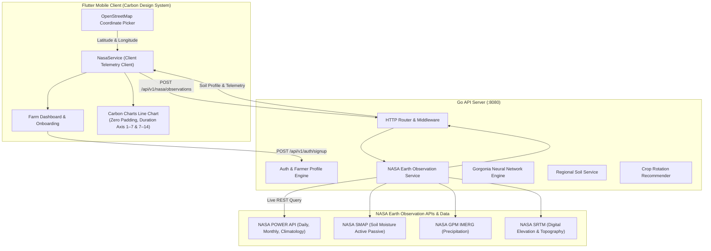

# Kilimo — Climate-Resilient Agroclimatology & Crop Rotation Decision Support

Kilimo is a full-stack, satellite-informed agricultural decision support platform built for smallholder farmers and agronomists in Kenya. Developed for the **NASA Space Apps Challenge (Resilient Crop Rotations)**, Kilimo pairs NASA Earth Observations (SMAP, GPM, NASA POWER, SRTM) with machine learning, regional soil physics, and an agronomic crop catalog to evaluate climate stress, optimize rotations, and provide actionable farm advisories.

The system features a **Go backend microservice** and a **Carbon Design System Flutter mobile application** equipped with customizable Carbon Charts, interactive OpenStreetMap onboarding, and multi-granularity agroclimate dashboards.

---

## Architecture Overview



---

## How NASA Data is Used in Kilimo

Kilimo ingests and synthesizes multi-mission NASA Earth Observation datasets across both the Go backend and the Flutter client:

### 1. NASA POWER (Prediction of Worldwide Energy Resources)
- **API Endpoints:**
  - `https://power.larc.nasa.gov/api/temporal/daily/point`: 14-day daily precision telemetry.
  - `https://power.larc.nasa.gov/api/temporal/monthly/point`: 12-month aggregated timelines.
  - `https://power.larc.nasa.gov/api/temporal/climatology/point`: Multi-year agroclimate baselines.
- **Parameters:**
  - `T2M`: Temperature at 2 meters (°C, daily mean, minimum, and maximum).
  - `PRECTOTCORR`: Precipitation corrected ($mm/day$).
  - `GWETTOP`: Surface soil wetness index ($0.0 - 1.0$).
  - `RH2M`: Relative humidity at 2 meters (%).
  - `ALLSKY_SFC_SW_DWN`: All-sky surface shortwave solar downward irradiance ($MJ/m^2/day$).

### 2. NASA SMAP (Soil Moisture Active Passive)
- Provides calibrated volumetric surface ($0\text{--}5\text{ cm}$) and root-zone ($0\text{--}100\text{ cm}$) soil moisture in $m^3/m^3$.
- Identifies soil moisture anomalies and computes the **Drought Stress Index** (Normal, Mild, Moderate, Severe) to alert farmers of subterranean moisture deficit before visible crop wilting occurs.

### 3. NASA GPM IMERG (Global Precipitation Measurement)
- Tracks precipitation frequency, intensity, and historical rainfall reliability.
- Pinpoints bimodal rainy seasons in East Africa (Long Rains in March–May; Short Rains in October–December).
- Computes runoff and topsoil erosion hazards from extreme rain events ($>50\text{ mm}$ in 24 hours).

### 4. NASA SRTM (Shuttle Radar Topography Mission)
- Supplies digital elevation data (meters above sea level) and terrain slope percentages.
- Combined with soil texture to determine terracing requirements, drainage characteristics, and water table retention.

### 5. Automated Onboarding Soil Profiling
- When a farmer taps their location on the OpenStreetMap interface during registration, Kilimo automatically passes the coordinates to the NASA telemetry pipeline.
- The platform resolves elevation, surface wetness, and climate baseline to auto-populate the farm's soil classification (e.g., Humic Nitisol, Ferralsol, Arenosol), texture, pH, and organic matter percentage.

---

## Carbon Charts Line Chart Implementation

The Flutter frontend features a custom, tokenized implementation of the **Carbon Design System Line Chart** ([`frontend/lib/core/components/line_chart/`](file:///home/ryan/kilimo/frontend/lib/core/components/line_chart/)):

- **Zero-Padding Edge-to-Edge Layout (`removePadding: true`):**
  Matches Carbon Charts' `addSpaceOnEdges: 0` specification, removing horizontal gutters and allowing series lines to stretch flush from the left Y-axis boundary to the right edge of the card.
- **Fixed Duration Axis (Ranges 1–7 and 7–14):**
  In Daily mode, data is plotted across a 14-day observation cycle. Rather than crowding all 14 date labels into a squeezed row, the chart displays clean ticks at **1**, **7**, and **14**, clearly defining the week 1 (**1 to 7**) and week 2 (**7 to 14**) duration ranges while remaining flush at the edges.
- **Canonical Monthly Timeline:**
  In Monthly mode, dates are rendered as canonical month names (`Jan` through `Dec`), eliminating ambiguous date formats (`01/01`).
- **Multi-Series Grouping:**
  Plots Soil Moisture (Teal 40), Mean Temperature (Red 50), and Precipitation (Blue 50) simultaneously with smooth cubic bezier curves, translucent area fills, and interactive point hover/tap inspection.

---

## Backend API Specification

The Go backend listens on `:8080` (configurable via `PORT`):

| Method | Endpoint | Description |
| :--- | :--- | :--- |
| `GET` | `/health` | Service health status (server, database, ML engine) |
| `POST` | `/api/v1/auth/signup` | Register farmer with geospatial coordinates and soil profile |
| `POST` | `/api/v1/auth/login` | Authenticate farmer and return session token |
| `GET` | `/api/v1/farm/profile` | Retrieve farmer profile, coordinates, and soil attributes |
| `POST` | `/api/v1/nasa/observations` | Multi-source NASA Earth Observation data for coordinates |
| `GET` | `/api/v1/nasa/metrics-info` | Educational dictionary of NASA agronomic indicators |
| `POST` | `/api/v1/analyze/vulnerabilities` | Diagnose bare soil windows and climate exposure |
| `POST` | `/api/v1/ml/predict-crop-suitability` | Gorgonia neural network crop suitability evaluation |
| `POST` | `/api/v1/rotations/recommend` | Model-driven resilient crop rotation sequences |
| `POST` | `/api/v1/rotations/simulate` | Climate scenario stress simulation (temperature/rainfall shifts) |

### Example Request: NASA Observations
```bash
curl -X POST http://localhost:8080/api/v1/nasa/observations \
  -H "Content-Type: application/json" \
  -d '{"latitude": -0.3031, "longitude": 36.0800}'
```

---

## Running the Project

### Prerequisites
- **Go:** 1.22+
- **Flutter SDK:** 3.19+
- **Network Access:** To reach NASA POWER API endpoints

### 1. Start the Go Backend
From the project root:
```bash
# Run unit and integration tests
go test ./...

# Start the API server on :8080
go run ./cmd/api
```

### 2. Launch the Flutter Client
From the project root:
```bash
cd frontend

# Install Flutter dependencies
flutter pub get

# Run test suite (14 unit & widget tests)
flutter test

# Launch the app
flutter run
```

---

## Project Structure

```
kilimo/
├── cmd/
│   └── api/                # Go backend main entry point
├── internal/
│   ├── auth/               # Session & token authentication
│   ├── crops/              # Agronomic crop catalog & nutrient database
│   ├── database/           # PostgreSQL persistence service
│   ├── ml/                 # Gorgonia neural network suitability engine
│   ├── models/             # Domain schemas (Farmer, Location, Soil)
│   ├── nasa/               # NASA Earth Observations aggregator & client
│   ├── rotation/           # Crop rotation sequence generator
│   ├── server/             # Gin HTTP routes & middleware
│   └── soil/               # Regional soil physics & chemistry profiles
├── frontend/
│   ├── lib/
│   │   ├── core/
│   │   │   ├── components/ # Carbon Design System Flutter components
│   │   │   │   ├── line_chart/         # Carbon Charts line chart
│   │   │   │   ├── bottom_app_bar/     # Carbon bottom navigation bar
│   │   │   │   ├── select/             # Carbon dropdown selector
│   │   │   │   └── progress_indicator/ # Step indicator
│   │   │   ├── services/   # NasaService & local client APIs
│   │   │   └── theme/      # Carbon tokens, themes & color palettes
│   │   └── feature/
│   │       ├── authentication/ # 10-step OSM geospatial signup & login
│   │       └── home/           # Dashboard & NasaClimateChartCard
│   └── test/               # Flutter test suite
├── training_data/          # Kenya climate history & soil catalog CSVs
├── Dockerfile              # Multi-stage container build
├── docker-compose.yml      # Service orchestration
└── README.md
```
